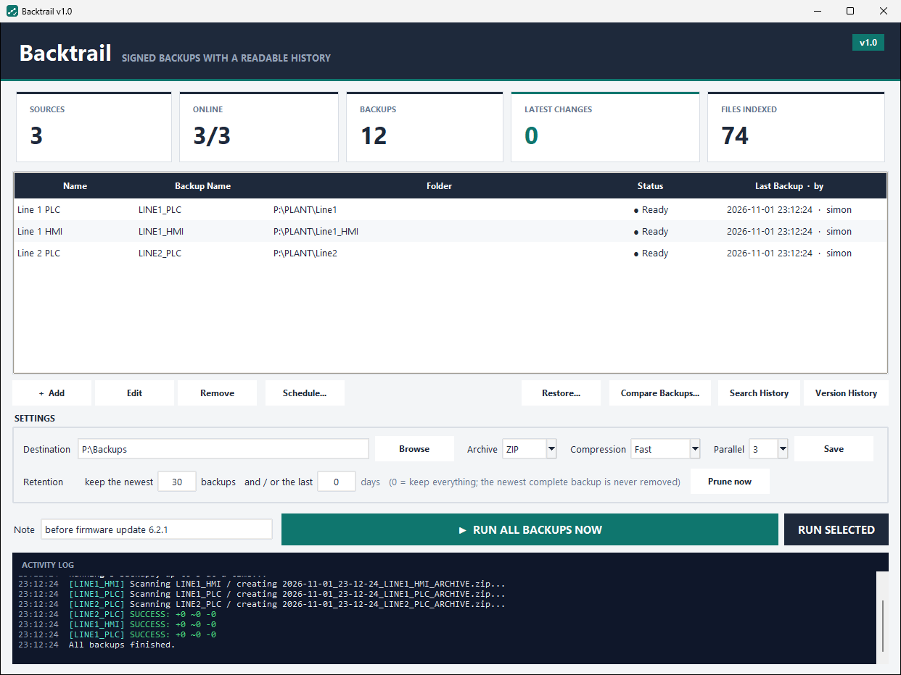

<p align="center"></p>

<h1 align="center">Backtrail</h1>
<p align="center"><b>Signed backups with a readable history.</b><br>
A Windows desktop tool that backs up the folders that run your machines, writes down exactly what changed and who changed it, signs every backup, and puts files back when it has to.</p>

---

Backtrail is for the folders that run a machine, a line or a plant: PLC exports, machine parameters, CSV recipe tables, JSON settings. Those folders change in small, undocumented ways, and after an incident nobody can say what was different last week or who touched it. Backtrail turns every backup into evidence.

Each run of a source produces three files:

| File | What it is |
|---|---|
| `<stamp>_<name>_ARCHIVE.zip` (or `.rar`) | The archive of the folder. Opens with Explorer or WinRAR like any other. |
| `<stamp>_<name>_CHANGELOG.txt` | Added, modified and deleted files since the previous backup; for `.json` files the exact keys that changed, old value to new. Headed by who took it, on which PC, manual or scheduled, and why. |
| `<stamp>_<name>_MANIFEST.json` | Every file with its size and SHA-256, plus the metadata, sealed with an Ed25519 signature. |



## What it does

- **Captures** any number of local or UNC folders, in parallel, as ZIP (built in) or RAR (with WinRAR). Files in use are skipped and listed, never a reason to abort.
- **Explains** every change. The changelog is written from two manifests, so no archive is unpacked and a run takes about as long as the compression alone.
- **Records who and why.** The Windows user, the machine, manual or scheduled, and a free-text note travel with every backup.
- **Compares any two backups**, however far apart, including the list of runs in between with their authors and notes. Also two plain archive files from anywhere.
- **Signs** every manifest with a key pair created for the user on first use. A changed file, a changed manifest or a changed author claim all verify as INVALID. `Backtrail.exe --verify` checks everything and exits 1 on a problem.
- **Restores** a whole backup or selected files, into a new folder or over the live source. Every file is checked against the signed fingerprint before anything is written; a restore over the source takes a signed safety backup first.
- **Searches** all changelogs for a file name, a parameter or a value.
- **Runs daily** through a Windows scheduled task, with no window and no admin rights.
- **Prunes** old backups by count or age; the newest complete backup is never removed.

## Quick start

Run from source (Python 3.10 or newer, Tkinter included in the standard Windows installer):

```bat
pip install -r requirements.txt
python backtrail.py
```

Or build a self-contained folder and run `dist\Backtrail\Backtrail.exe`:

```bat
build.bat
```

Then, in the window:

1. **Browse** next to *Destination* and pick where backups go.
2. **+ Add** a source: a name, a backup name and the path of the folder.
3. Type a **Note** and press **RUN ALL BACKUPS NOW**.
4. **Schedule…** to run every day by itself.

A demo folder is included under `demo/` to try it without touching anything real.

## Command line

```bat
Backtrail.exe --run                         back up every source, no window (what the scheduled task runs)
Backtrail.exe --run --note "after firmware"  the same, with a note stamped into the backup
Backtrail.exe --verify [folder]             re-check every signature and archive, exit 1 on a problem
```

## Digital signatures, in short

The SHA-256 fingerprint of a file proves *what* it is; any tool computes the same value for the same bytes. The signature proves *who* vouched for the list of fingerprints: the private key stays in `%APPDATA%\Backtrail\keys`, the public key is published to `<Destination>\_keys\<user@host>.pub` for everyone to verify. Version History marks each backup as signed, INVALID, untrusted key or unsigned. Signing needs the `cryptography` package; without it Backtrail still works, unsigned, and says so.

## Layout

```
backtrail.py            the window, the scheduled task helpers, --run and --verify
backup_engine.py        scanning, hashing, archiving, manifests, changelogs, compare, restore, retention, signatures
tests/                  pytest suite for the engine (no WinRAR needed):  python -m pytest -q tests
docs/GUIDE.md           the full user guide
docs/screenshots/       what the windows look like (regenerate with docs/make_screenshots.py)
docs/website/           a product page you can drop into a website
config.example.json     copy to config.json, or let the window create it
Backtrail.spec          PyInstaller build (one-dir, because one-file self-extractors trip some antivirus scanners)
```

`config.json`, `state.json`, logs and build outputs are ignored by git: a real configuration holds your network paths.

## License

MIT. See [LICENSE](LICENSE).
